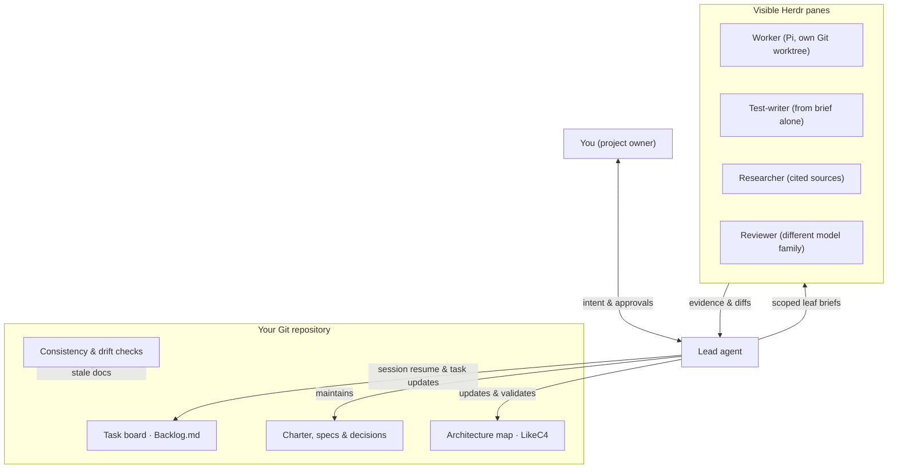

# project-manager

[](#status)
[](LICENSE)


[](https://github.com/MrLesk/Backlog.md)
[](https://code.claude.com)

[Getting started](docs/getting-started.md) · [Package guide](template/.pm/README.md) · [Principles](template/.pm/principles.md)

A shared, file-based workspace where you and coding agents from different model families run a software project inside Git.

It is neither a harness nor a framework. It combines existing open tools with plain Markdown records and standard-library Python checks.

## How the parts fit together



### Records

- **Tasks:** Markdown files in Backlog.md, viewed with `backlog browser`.
- **Decisions and specs:** One file per decision, a project charter, and Epic specifications.
- **Architecture:** System model in LikeC4.
- **One home per fact:** Each fact lives in one file and is linked, never duplicated.

### Roles

- **Lead:** Frames tasks, writes scoped leaf briefs, verifies evidence, and owns living docs. Any capable agent can fill this role, including in Pi; setup installs Claude Code today.
- **Worker:** Runs one leaf brief in an isolated Git worktree inside a visible Herdr pane.
- **Test-writer & researcher:** Write tests from the brief alone or collect cited sources.
- **Reviewer:** Reviews the brief, diff, and report from a different model family than the author.

### Principles

- **Smallest change** that solves the stated problem.
- **Subtract first** before adding rules, files, or steps.
- **Minimize reader load** with short prose and decisions up front.
- **Prove it works** with command output, tests, or measurements.
- **Guard the context window** by delegating bulk reading and leaf work.

### Checks and continuity

- **Commit gate:** Pre-commit hook that blocks dead links, superseded decisions, oversized docs, and unverified Done tasks.
- **Drift check (`python .pm/tools/pm_check.py --stale`):** Lists docs whose `describes:` files changed in Git since their `reviewed:` marker.
- **Session resume (`python .pm/tools/pm_board.py --resume`):** Session hook comparing Git status, active tasks, and worktrees at session start.
- **Skills:** `/pm-setup` (onboarding), `/pm-grill-me` and `pm-grilling` (design stress-test), `/pm-scratch` (side ideas), `/pm-feedback` (redacted bug report, sent only on your yes).

## Layers

| Layer           | Default              | Contents                                                                                                            |
| --------------- | -------------------- | ------------------------------------------------------------------------------------------------------------------- |
| **Core**  | Always on            | Python, Git, Node.js, Claude Code, Backlog.md, conventions and checks, session hooks, Context7 MCP, `pm-` skills. |
| **Map**   | On (`--map`)       | LikeC4 CLI (`npx likec4@1.59.4 start`), LikeC4 MCP server, `pm-likec4-dsl` skill.                               |
| **Swarm** | Opt-in (`--swarm`) | Pi, Herdr, and the swarm runner for visible worker panes and evidence checks.                                       |

## Install

Requires **Python 3.11+** and **Git** in a Git repository (`git init`). Clone `project-manager` **next to** your project and run the setup TUI:

```bash
git clone https://github.com/Kscl1/project-manager.git
cd project-manager
python -m venv tools/setup/.venv

# Windows PowerShell
tools/setup/.venv/Scripts/python -m pip install -r tools/setup/requirements.txt
tools/setup/.venv/Scripts/python tools/setup/app.py "C:/projects/my-project"

# Linux (Omarchy / Arch-based)
tools/setup/.venv/bin/python -m pip install -r tools/setup/requirements.txt
tools/setup/.venv/bin/python tools/setup/app.py ~/projects/my-project
```

- **Safe by default:** `Check` is read-only, each install step waits for `y`, and existing project files are never overwritten.
- **Next step:** Open your project in your coding agent and run `/pm-setup`.
- **Full guide and manual path:** See [`docs/getting-started.md`](docs/getting-started.md).

## Status

- **Stage:** Alpha; expect breaking changes. New alpha releases will come quickly.
- **Platforms:** Tested end to end on Windows; Linux not tested yet.
- **Licence and support:** [MIT](LICENSE). Experimental, best-effort support with no promised response time.

## Credits

### Built on

- **[Backlog.md](https://github.com/MrLesk/Backlog.md)** — task board and backbone of the project.
- **[Claude Code](https://code.claude.com)** — coding agent installed by setup today.
- **[Pi](https://github.com/earendil-works/pi)** — coding agent harness for workers and leads.
- **[Herdr](https://herdr.dev)** — runs worker agents in visible terminal panes.
- **[LikeC4](https://likec4.dev)** — architecture model, CLI, and MCP server.
- **[Context7](https://github.com/upstash/context7)** — MCP server for current library documentation.
- **[gitleaks](https://github.com/gitleaks/gitleaks)** and **[ruff](https://github.com/astral-sh/ruff)** — secret scanning and Python checks on this repo.

### Adapted

- **Matt Pocock's [skills](https://github.com/mattpocock/skills)** (MIT).
- **[pstack](https://github.com/cursor/plugins/tree/main/pstack)** (MIT) — our [working principles](template/.pm/principles.md).

### Thanks

- Inspired by OpenAI's [harness engineering](https://openai.com/index/harness-engineering/) write-up.
- Inspired by [kontext](https://github.com/patkusch/kontext).
- Inspired by [ADR and MADR](https://adr.github.io/madr/).
- Inspired by [Everything Claude Code](https://github.com/affaan-m/everything-claude-code).
