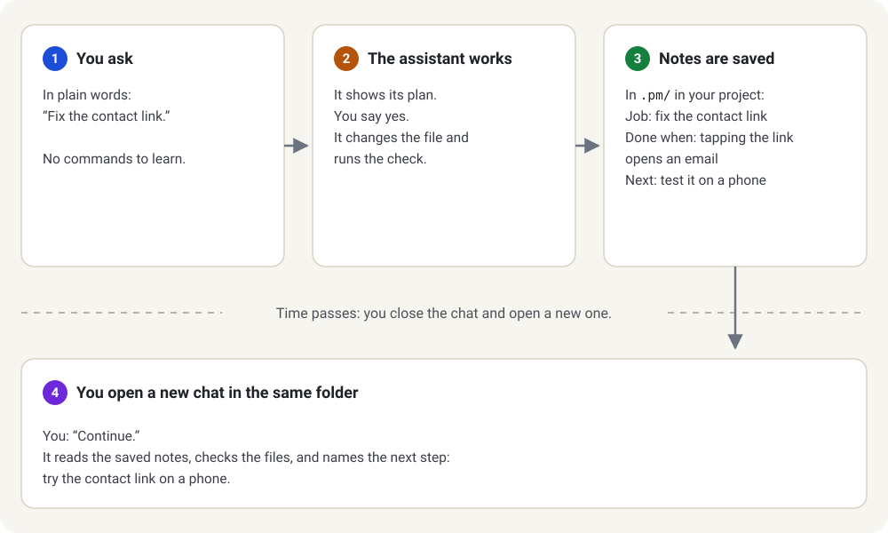

Used ChatGPT or Gemini on a phone? You already know how to ask in plain words. On a computer, with a project folder, those words do more: the assistant reads and changes real files, and project-manager gives it a notebook, so the next chat starts where you stopped.

## The folder

A project is a folder on your computer, for example `C:\projects\my-site`. Everything below happens inside it: your code, and the notes project-manager adds. You open that folder in your assistant, and it starts there. Git is the program that records each change to a folder; if yours has no Git history yet, setup offers to start one.

## The assistant

The assistant is an AI program that can also use the folder: Claude Code from Anthropic, Codex from OpenAI, Pi or another. You type ordinary words, as on your phone; it edits files and runs checks when allowed. You open it in a terminal, the text window where you type commands, or in Claude Desktop's **Code** tab, which needs a paid Claude plan. It runs on your computer, not on a website, and the service may charge for what you use.

## Permission

The assistant can change your files, so it has to ask. Read its plan before you say yes; "no" is a decision too. This setup asks before changing your files; your assistant's own permission settings matter too. The AI can make mistakes; check what it did.

## Saved notes

The assistant forgets most of a chat when it closes. project-manager keeps the work in files instead: the job list, the reasons and where you stopped, in `.pm/` inside your project — a folder whose name starts with a dot, which some file windows hide. It is the project's notebook, not the AI's memory: a new chat reads the notes and checks the files again.



*The new chat reads saved files, not the old assistant's mind.*

## Install

Open your project folder in the assistant and paste this prompt, the text that asks for the work, into its chat box:

```text
Install project-manager into my project. Read all of https://raw.githubusercontent.com/Kscl1/project-manager/main/docs/install-with-agent.md, follow it step by step, ask me before every change, and stop where it says to stop.
```

The assistant follows [Install with your agent](install-with-agent.md). When it is done, open the project in a new chat and type `/pm-setup` there (Pi: `/skill:pm-setup`, Codex: `$pm-setup`).
