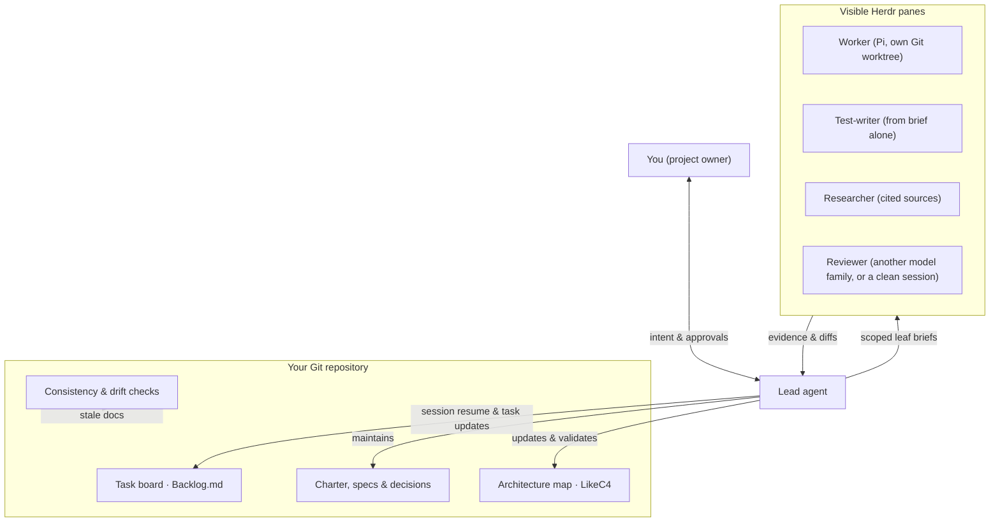

New words (task, Epic, brief, commit) are in the [glossary](glossary.md).

## One request, from intent to evidence

1. **You describe the goal.** The lead agent opens a task with acceptance criteria before doing the work. Larger goals become an Epic with small, scoped tasks.
2. **The lead checks the context.** It reads the current task, the relevant project records and the code, then chooses the smallest useful change.
3. **Work happens in the repository.** The lead can do a small job itself. With the optional swarm layer, it gives a worker a brief, an isolated Git worktree and a visible terminal pane.
4. **Evidence comes back.** The lead reads the diff and checks the evidence. Code to be merged into the main branch, and changes touching security, data, money, permissions or a public release, get an independent review. The reviewer uses a different model family, or a fresh session when the project has only one family. Other undoable work can close with a recorded `Review: lead self-check`.
5. **You decide where consent is needed.** The lead reports what passed and what remains. It asks before the specified safety boundaries, including changes to your files outside `.pm/`. You decide when to merge into the main branch.

## The parts together



The diagram's worker roles belong to the optional swarm. The core works with a lead alone; add other roles when the work justifies them.

## Who does what?

| Role | Responsibility |
|---|---|
| You, the project owner | Set intent, resolve important choices and approve merging. |
| Lead | Frame the task, keep the live records current, write scoped briefs and verify the evidence. Any capable agent can fill this role. |
| Worker | Complete one scoped brief; do not expand the job or edit the lead's records. |
| Test-writer or researcher | Test from the brief or gather cited sources, rather than assume the implementation is right. |
| Reviewer | When the risk calls for independent review, read the brief, diff and evidence with fresh context, from a different model family than the author (one-family projects: a fresh session, recorded as same-family). |

## What runs where?

| Place | What is there |
|---|---|
| Your machine | Git, Python and Node.js; your coding agent; optionally LikeC4, Pi and Herdr. Model requests still go to the provider you configure: local files do not mean local inference. |
| The project-manager clone | The installer and setup screen. Keep this clone next to your project, not inside it. |
| Your project's `.pm/` | Tasks, charter, specs, decisions, lessons (`lessons.md`, started with the first lesson), role cards, tools and hooks. These records are tracked in your project's Git history. |
| Your project's own folders | Application code, tests and product documentation. They remain separate from the work-system package. |
| A worker worktree and Herdr pane | With Swarm enabled, an isolated working directory and a terminal you can watch and intervene in. The runner records state and checks completion evidence. |
| GitHub | Your remote repository and any CI you configure. This documentation site is static: it does not run your agents or upload your project records. |

The [package guide](https://github.com/Kscl1/project-manager/blob/main/template/.pm/README.md) describes the installed files and which ones upgrades preserve.

## Pick up the next session

Session hooks show Git state and the active tasks when work starts or context is compacted. You can request the same view yourself from your project:

```bash
python .pm/tools/pm_board.py --resume
```

The lead then reads the active task and continues from its live notes. Task state belongs in Backlog.md, not in a second checklist elsewhere.

Before committing, the package's hooks run consistency checks and call any project-specific checks you configured. The drift check can also flag documentation whose described code changed. Neither can prove that prose is true or software behaves correctly: that still needs code review, tests and real use.

Ready to try it? Follow [getting started](getting-started.md). For the underlying rules, read the [working principles](https://github.com/Kscl1/project-manager/blob/main/template/.pm/principles.md).
