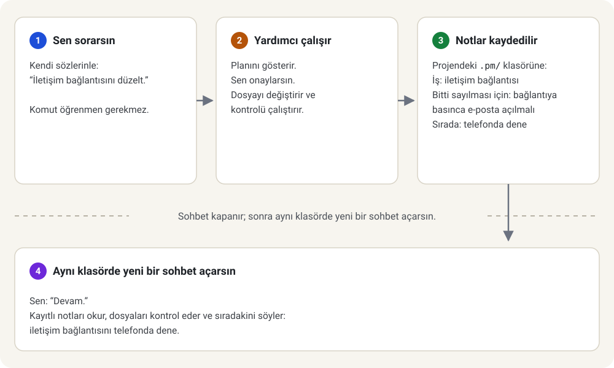

ChatGPT ya da Gemini'yi telefonda kullandın mı? Ne istediğini kendi sözlerinle anlatmayı zaten biliyorsun. Bilgisayarda, bir proje klasörü açınca aynı cümleler daha fazlasını yapar: yardımcı gerçek dosyaları okuyup değiştirebilir. project-manager ona not tutacağı bir iş defteri verir; yeni sohbet kaldığın yerden başlar. Anlatılanların hepsi beş başlıkta, karşına çıkacakları sırayla.

## Klasör

Bir proje, bilgisayarındaki bir klasördür; örneğin `C:\projects\sitem`. Aşağıdaki her şey o klasörün içinde olur: kodun ve project-manager'ın eklediği notlar. Yardımcıyı o klasörde açarsın, oradan başlar. Git, bir klasördeki her değişikliği kaydeden programdır; klasöründe henüz Git geçmişi yoksa kurulum bir tane başlatmayı önerir.

## Yardımcı

Yardımcı, klasörü de kullanabilen bir yapay zekâ programıdır: Anthropic'in Claude Code'u, OpenAI'nin Codex'i, Pi ya da başka biri. Telefonda olduğu gibi günlük dille yazarsın; izin verildiğinde dosyaları düzenler ve kontrolleri çalıştırır. Onu bir terminalde, yani komut yazdığın metin penceresinde, ya da Claude Desktop'ta **Code** sekmesinde açarsın; Code sekmesi ücretli bir Claude planı ister. Tarayıcıda açtığın bir site değildir, bilgisayarında çalışır ve arkasındaki hizmet kullanım miktarına göre ücret alabilir.

## İzin

Yardımcı dosyalarını değiştirebildiği için sana sormalıdır. "Evet" demeden önce planını oku; "hayır" da bir karardır. Bu kurulum dosyalarını değiştirmeden önce sana sorar; yardımcının kendi izin ayarları da önemlidir. Yapay zekâ hata yapabilir; ne yaptığını kontrol et.

## Saklanan notlar

Yardımcı, sohbet kapanınca konuşulanların çoğunu unutur. project-manager işi bunun yerine dosyalarda tutar: iş listesi, seçimlerin nedenleri ve nerede kaldığın, projenin içindeki `.pm/` klasöründe. Adı noktayla başlayan bu klasörü bazı dosya pencereleri gizler. O klasör projenin iş defteridir, yapay zekânın belleği değil: yeni sohbet notları okur ve dosyaları yeniden kontrol eder.



*Yeni sohbet, eski yardımcının aklını değil kayıtlı dosyaları okur.*

## Kurulum

Proje klasörünü yardımcıda aç ve işi anlatan şu metni sohbet kutusuna yapıştır:

```text
project-manager'ı projeme kur. https://raw.githubusercontent.com/Kscl1/project-manager/main/docs/tr/install-with-agent.md sayfasının tamamını oku, adım adım izle, her değişiklikten önce bana sor ve sayfanın dur dediği yerde dur.
```

Yardımcı [Yardımcınla kur](install-with-agent.md) sayfasını izler. Bitince projeyi yeni bir sohbette aç ve oraya `/pm-setup` yaz (Pi'de `/skill:pm-setup`, Codex'te `$pm-setup`).
