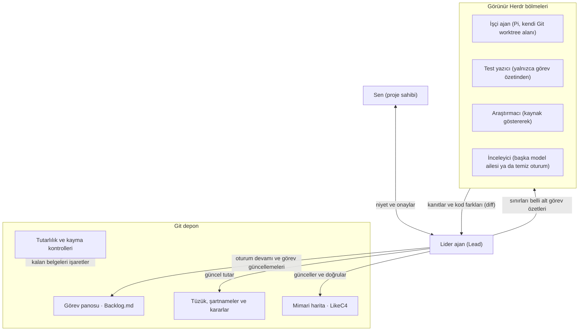

Görev, Epic, brief, commit gibi yeni kelimeler [sözlükte](glossary.md).

## Niyetten kanıta tek bir istek

1. **Hedefi sen anlatırsın.** Lider ajan (`lead`, işi planlayan ve çıktıları doğrulayan ana kodlama ajanı), işe başlamadan önce kabul ölçütleri (`acceptance criteria`, işin tamamlanmış sayılması için gereken koşullar) içeren bir görev (yapılacak iş kaydı) açar. Daha büyük hedefler, küçük ve sınırları belli alt görevlerden oluşan bir `Epic` (üst görev) hâline gelir.
2. **Lider ajan bağlamı kontrol eder.** Mevcut görevi, ilgili proje kayıtlarını ve kodu okur; ardından işe yarayacak en küçük değişikliği seçer.
3. **İş doğrudan depoda yapılır.** Lider ajan küçük bir işi kendi başına yapabilir. İsteğe bağlı sürü katmanı (`swarm`, birden fazla yardımcı ajanın birlikte çalışması) açıksa bir işçi ajana (`worker`, tek bir alt işi yapan yardımcı ajan) kısa bir görev özeti (`brief`, yapılacak alt işin talimatı), yalıtılmış bir Git çalışma ağacı (`git worktree`, aynı deponun o iş için ayrılmış çalışma klasörü) ve ekranda görebileceğin bir terminal bölmesi verir.
4. **Kanıtlar geri döner.** Lider ajan kod farkını (`diff`, satır satır değişiklikler) okur ve kanıtları kontrol eder. Ana dala (`main branch`) birleştirilecek kod ile güvenlik, veri, para, izinler veya herkese açık yayın içeren değişiklikler bağımsız inceleme alır. İnceleyici farklı bir model ailesi kullanır; tek aile varsa yeni bir oturum kullanır. Geri alınabilir diğer işler kayıtlı `Review: lead self-check` (liderin kendi kontrolü) ile kapanabilir.
5. **Onay gereken yerde sen karar verirsin.** Lider ajan nelerin geçtiğini ve neyin kaldığını bildirir. Güvenlik sınırlarından önce, örneğin `.pm/` dışındaki dosyalarını değiştirmeden önce sorar. Ana dala ne zaman birleştirileceğine (`merge`) sen karar verirsin.

## Parçalar bir arada



Şemadaki işçi rolleri isteğe bağlı sürü (`swarm`) katmanına aittir. Çekirdek katman tek başına bir lider ajanla çalışır; diğer rolleri yalnızca iş gerektirdiğinde eklersin.

## Kim ne yapar?

| Rol | Sorumluluk |
|---|---|
| Sen (proje sahibi) | Hedefi belirler, önemli seçimleri karara bağlar ve birleştirmeyi (`merge`) onaylarsın. |
| Lider (`Lead`) | Görevi çerçeveler, canlı kayıtları güncel tutar, sınırları belli görev özetleri (`brief`) yazar ve kanıtları doğrular. Yeterli her kodlama ajanı bu rolü üstlenebilir. |
| İşçi (`Worker`) | Sınırları belli tek bir görev özetini tamamlar; işi büyütmez ve liderin kayıtlarını düzenlemez. |
| Test yazıcı veya araştırmacı | Yazılan kodun doğru olduğunu varsaymak yerine, doğrudan görev özetine göre test yazar ya da kaynak göstererek bilgi toplar. |
| İnceleyici (`Reviewer`) | Risk bağımsız inceleme gerektirdiğinde görev özetini, kod farkını (`diff`) ve kanıtları, yazardan farklı bir model ailesiyle ve temiz bir bağlamda okur; tek aileli projede aynı modelin yeni bir oturumu inceler ve bu kaydedilir. |

## Ne nerede çalışır?

| Yer | Orada ne var? |
|---|---|
| Senin bilgisayarın | Git, Python ve Node.js; kodlama ajanın; isteğe bağlı olarak LikeC4, Pi ve Herdr. Model istekleri yine ayarladığın sağlayıcıya (modeli çalıştıran servise) gider: dosyaların yerel olması, yapay zekâ modelinin bilgisayarda çalıştığı (`local inference`) anlamına gelmez. |
| project-manager klonu | Kurucu ve kurulum ekranı. Bu klonu kendi projenin içinde değil, yanında tut. |
| Projenin `.pm/` klasörü | Görevler, proje tüzüğü (`charter`, projenin amacı), şartnameler (`specs`), karar kayıtları (`decision record`, bir seçimin neden yapıldığını anlatan kayıtlar), çıkarılan dersler (`lessons.md`, ilk dersle birlikte başlar), rol kartları (her ajan rolünün kuralları), araçlar ve kancalar (`hooks`, belirli olaylarda otomatik çalışan betikler). Bu kayıtlar projenin Git geçmişinde izlenir. |
| Projenin kendi klasörleri | Uygulama kodu, testler ve ürün belgeleri. Bunlar çalışma sistemi paketinden ayrı kalır. |
| İşçi çalışma ağacı (`worktree`) ve Herdr bölmesi | Sürü (`Swarm`) katmanı açıkken, yalıtılmış bir çalışma klasörü ve izleyip müdahale edebileceğin bir terminal bölmesi. Çalıştırıcı (`runner`, işçileri başlatıp denetleyen araç) durumu kaydeder ve tamamlanma kanıtlarını kontrol eder. |
| GitHub | Uzak (`remote`) Git depon ve ayarladığın sürekli entegrasyon (`CI`, her kod gönderiminde çalışan otomatik kontroller) akışları. Bu dokümantasyon sitesi durağandır (`static`): ajanlarını çalıştırmaz ve proje kayıtlarını internete yüklemez. |

[Paket rehberi](https://github.com/Kscl1/project-manager/blob/main/template/.pm/README.md), kurulan dosyaları ve yükseltme sırasında hangilerinin korunduğunu açıklar.

## Sonraki oturumda kaldığın yerden devam et

Oturum kancaları (`session hooks`), çalışma başladığında veya sohbet belleği özetlendiğinde (`compacted`, uzun sohbet geçmişinin yer açmak için kısaltılması) Git durumunu ve aktif görevleri gösterir. Aynı görünümü kendi projende şu komutla kendin de isteyebilirsin:

```bash
python .pm/tools/pm_board.py --resume
```

Bunun ardından lider ajan aktif görevi okur ve görevin canlı notlarından devam eder. Görev durumu, başka bir yerdeki ikinci bir kontrol listesinde değil, Backlog.md içinde tutulur.

Değişiklikleri Git'e kaydetmeden (`commit`) önce paketin kancaları tutarlılık kontrollerini çalıştırır ve senin ayarladığın projeye özel kontrolleri çağırır. Kayma kontrolü (`drift check`, kod ile belge arasındaki uyum kontrolü) ise anlattığı kod değişmiş olan belgeleri işaretleyebilir. İkisi de metinlerin doğru olduğunu ya da yazılımın hatasız çalıştığını kanıtlayamaz: bunun için yine kod incelemesi, testler ve gerçek kullanım gerekir.

Denemeye hazır mısın? [Başlangıç rehberini](getting-started.md) izle. Arka plandaki kurallar için [çalışma ilkelerini](https://github.com/Kscl1/project-manager/blob/main/template/.pm/principles.md) oku.
